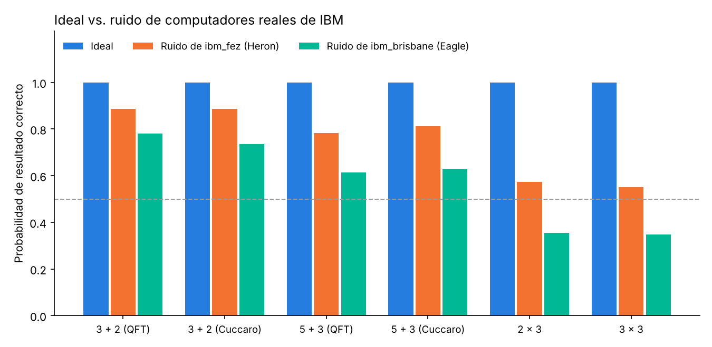
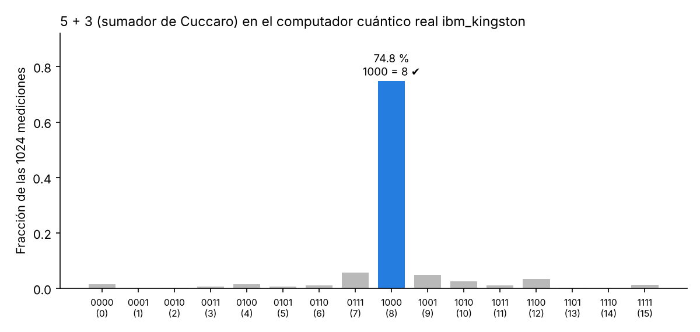

# Calculadora cuántica (suma y multiplicación)

[](https://colab.research.google.com/github/tanmacre1998-art/CC_A_Complejo/blob/main/notebooks/calculadora_cuantica.ipynb)

Proyecto para la materia de **Análisis Complejo**. La idea era hacer una calculadora que sume y multiplique
números, pero usando circuitos cuánticos en vez de una calculadora normal. Lo hicimos en Python con Qiskit.

Lo que nos llamó la atención (y por qué tiene que ver con la materia) es que la forma más común de sumar en un
computador cuántico usa la **Transformada Cuántica de Fourier**, que al final son sumas de raíces de la unidad
$e^{2\pi i k/N}$. Sumar dos números termina siendo **rotar fases en el círculo unitario**, porque
$e^{i\alpha}\cdot e^{i\beta} = e^{i(\alpha+\beta)}$.

## Autores

* José Mauricio Naged Lancheros
* Manuel Armando Jerez Gamboa
* Miguel Kratzer Giraldo
* Andrés Felipe Ramírez Sarmiento

## Qué hicimos

* **Suma con la QFT** (sumador de Draper): se pasa un número al "espacio de Fourier" y ahí sumarle otro es solo girar fases.
* **Suma "normal"** (sumador de Cuccaro): como el sumador de acarreo de electrónica digital, pero con compuertas reversibles (CNOT y Toffoli). La hicimos para comparar con la de la QFT.
* **Multiplicación**: como se multiplica a mano, desplazando y sumando, pero todas las sumas se hacen con fases.
* Probamos que diera bien con todas las combinaciones de números pequeños, y miramos cuántos qubits y compuertas
  gasta cada cosa y qué pasa si el computador tiene ruido.

Ejemplo:

```text
> 25 * 13
  25 × 13 = 325  ✔
```

## Cómo correrlo

Lo más fácil es darle al botón de **Abrir en Colab** de arriba y ejecutar todas las celdas (la primera instala Qiskit, se demora un poquito).

En el computador:

```bash
git clone https://github.com/tanmacre1998-art/CC_A_Complejo.git
cd CC_A_Complejo
pip install -r requirements.txt
python main.py            # para escribir operaciones como 7 + 5 o 6 * 3
pytest -q                 # pruebas
```

## Carpetas

* `qcalc/` → el código de los circuitos (QFT, sumadores, multiplicador y la calculadora)
* `notebooks/` → el notebook con todo explicado paso a paso
* `tests/` → las pruebas
* `scripts/analisis.py` → hace las gráficas (se demora como 5 minutos por la parte de ruido)
* `figuras/` y `resultados/` → lo que sale del análisis
* `qasm/` → algunos circuitos en OpenQASM para abrirlos en el IBM Quantum Composer (copiar y pegar en el editor de código)

## ¿Y en un computador cuántico de verdad?

Con `scripts/comparar_hardware.py` comparamos la simulación ideal con el ruido calibrado de computadores reales de
IBM (Qiskit trae guardados los errores medidos en esos equipos). Con `--real` el mismo script manda los circuitos a
un computador cuántico real de IBM, usando una cuenta gratuita de IBM Quantum.

```bash
python scripts/comparar_hardware.py          # ideal vs. ruido de ibm_fez e ibm_brisbane
python scripts/comparar_hardware.py --real   # también en un computador real (necesita cuenta)
```



**Para correr cualquier otra operación en IBM:**

```bash
py scripts/ibm.py "7 + 6"            # crea qasm/op_7mas6_qft.qasm para pegar en el Composer
py scripts/ibm.py "7 + 6" --ripple   # con el sumador de Cuccaro
py scripts/ibm.py "3 * 2" --correr   # lo manda directo a IBM (con la API key guardada)
```

**¡Lo corrimos en un computador cuántico de verdad!** Pegamos `qasm/suma_5mas3_cuccaro.qasm` en el IBM Quantum Composer
y lo mandamos a **ibm_kingston** (156 qubits). De 1024 mediciones, el resultado correcto (`1000` = 8) salió el
**74,8 %** de las veces; el resto es ruido del computador. La simulación con el ruido de ibm_fez, que es del mismo tipo
(Heron r2), daba 81 %, así que quedó bastante cerca.



## Dificultades que tuvimos

Honestamente esto nos costó bastante más de lo que pensábamos:

* **Los bits al revés.** Qiskit guarda el qubit 0 como el bit menos significativo y además imprime los resultados
  al revés. Nuestras primeras sumas daban números que no tenían sentido (5 + 3 nos daba 1) hasta que entendimos eso.
* **Código viejo.** Encontramos un repo parecido ([QuantumDeskCalculator](https://github.com/lmarza/QuantumDeskCalculator))
  pero usaba `execute`, que ya no existe en Qiskit 2. Nos tocó aprender a usar `AerSimulator` y `transpile`.
* **La QFT no nos daba igual a la de Qiskit.** Era por los SWAP del final. Después los quitamos para ahorrar
  compuertas y se nos dañó la suma, porque los qubits quedan en orden inverso y hay que reacomodar los índices.
* **Los ángulos.** Nos confundimos varias veces con el $2\pi \cdot 2^{i+k}/2^L$ y los resultados salían
  multiplicados o divididos por 2.
* **El acarreo.** Al principio el registro del resultado tenía los mismos bits que los números y 7 + 1 nos daba 0.
  Faltaba un qubit extra.
* **La multiplicación es pesada.** Intentamos multiplicar números de 8 bits (32 qubits) y el computador se quedó
  pegado. Le pusimos un límite de 28 qubits.
* **Entender la QFT como tal** fue lo más difícil. Nos ayudó mucho verla como una transformada de Fourier
  discreta normal, con raíces de la unidad, que es lo que vimos en clase.

Usamos herramientas de IA como apoyo para entender conceptos y encontrar errores en el código.

## Referencias

* T. G. Draper, *Addition on a Quantum Computer* (2000), arXiv:quant-ph/0008033.
* S. A. Cuccaro et al., *A new quantum ripple-carry addition circuit* (2004), arXiv:quant-ph/0410184.
* L. Ruiz-Pérez y J. C. García-Escartín, *Quantum arithmetic with the Quantum Fourier Transform* (2017), arXiv:1411.5949.
* Nielsen y Chuang, *Quantum Computation and Quantum Information*, capítulo 5.
* Documentación de Qiskit.
